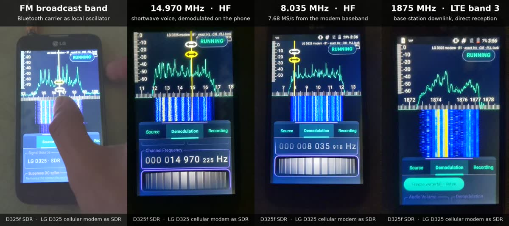

# D325f-SDR


Экспериментальный SDR-приёмник на встроенном сотовом модеме LG D325.
Проект и интеграция модемной части — **Logan Zarov**.

[English](README.md) · [Скачать 1.0.0](https://github.com/loganzarov-alt/D325f-SDR/releases/tag/v1.0.0) ·
[Сборка](docs/BUILD.md) · [Подготовка телефона](docs/DEVICE-SETUP.md) · [Аппаратная доработка: B8 и B1](docs/HARDWARE.md)

## Возможности

- Приём со встроенного модема LG и воспроизведение IQ-файлов.
- Спектр и водопад в реальном времени.
- Демодуляция AM, NFM, WFM, USB, LSB и CW.
- Запись IQ и демодулированного аудио.

IQ CI8 7,68 MS/s (около 5 МГц) прямо из baseband модема, частота задаётся патчем
прошивки модема; ниже 800 МГц гетеродином служит Bluetooth-передатчик телефона.
Тракт сигнала, характеристики и ограничения — в разделе [как это работает](docs/HOW-IT-WORKS.md#по-русски).

## Демо

[](docs/media/d325f-sdr-demo.mp4)

[Видео, 36 с](docs/media/d325f-sdr-demo.mp4): FM-диапазон, речь на КВ 14,970 МГц,
8,035 МГц и нисходящий LTE 1875 МГц — всё принимает собственный модем телефона.
Разбор IQ-записей с телефона (FM со стереопилотом и RDS, аналоговое ТВ 551,25 МГц,
КВ AM) — в разделе [как это работает](docs/HOW-IT-WORKS.md#recorded-examples).
[Скачать три исходные IQ-записи](https://github.com/loganzarov-alt/D325f-SDR/releases/tag/iq-samples-2026-10-23) (знаковый CI8, 7,68 MS/s; с SHA-256).

## Выпуск и требования

**1.0.0** — первый публичный выпуск, код версии **1**, ARMv7, Android 7.1+
(API 25). Опубликованный APK успешно проверен на доработанном LG D325
**24 октября 2026 года**.

Для приёма с модема нужны root-доступ, подготовленный телефон с подходящим
ядром ([исходник](kernel/README.md#по-русски)), настройками модема/IQ и системными QMI-библиотеками. Установка APK сама
по себе не подготавливает штатный телефон. Подробнее: [подготовка устройства](docs/DEVICE-SETUP.md)
и [фотографии доработки и распиновка переходника](docs/HARDWARE.md).
[Исходники ядра #6](https://github.com/loganzarov-alt/D325f-SDR/releases/tag/kernel-6-source): патч, конфиг и скрипт подготовки дерева; без boot.img и ZIP для прошивки ядра.

## Инструменты подготовки модема

[Modem Patcher 1.1.0 и TWRP ZIP 1.2](modem-patcher/README.ru.md) применяют и
обращают патч модема на собственном modem-разделе телефона. Перед первой записью
они сохраняют проверенный дамп и умеют восстанавливать из него.
[Скачать комплект](https://github.com/loganzarov-alt/D325f-SDR/releases/tag/modem-patcher-v1.1.0).
Инструменты успешно проверены на одном LG D325 24 октября 2026 года;
второй телефон не проверялся. Они не устанавливают ядро и не заменяют
аппаратную доработку.

## Сборка

Linux x86_64, JDK 17, Python 3 и Android SDK:

```sh
sdkmanager "platforms;android-34" "build-tools;35.0.0" \
  "ndk;27.2.12479018" "cmake;3.22.1"
export ANDROID_HOME=/путь/к/android-sdk
./gradlew --no-daemon :app:assembleRelease :app:testReleaseUnitTest
```

APK: `app/build/outputs/apk/release/app-release.apk`.
Приложение, DSP и собственные вспомогательные программы собираются из
Java/Kotlin/C/C++/ASM. [Сборка и подпись](docs/BUILD.md) · [Проверки](validation/README.md).
Проприетарные прошивки телефона и библиотеки производителя в репозиторий не входят.

## Авторство и лицензия

Приложение использует код **RF Analyzer — Dennis Mantz и других авторов**.
При разработке кода и документации использовались инструменты ИИ.

Объединённое приложение распространяется по **GPL-3.0-or-later**. Исходные
уведомления об авторстве и лицензии сторонних компонентов сохранены:
[LICENSING.md](LICENSING.md), [LICENSE](LICENSE) и раздел лицензий в приложении.
[Происхождение кода](docs/PROVENANCE.md). Проект независимый и не связан с официальной
поддержкой LG, Qualcomm или авторов исходного приложения.
