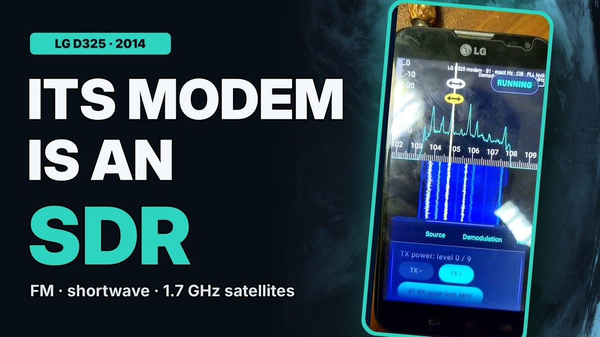

# D325f-SDR


Экспериментальный SDR-приёмник на встроенном сотовом модеме LG D325.
Проект и интеграция модемной части — **Logan Zarov**.

[English](README.md) · [Скачать 2.0](https://github.com/loganzarov-alt/D325f-SDR/releases/tag/v2.0) ·
[Сборка](docs/BUILD.md) · [Подготовка телефона](docs/DEVICE-SETUP.md) · [Аппаратная доработка: B8 и B1](docs/HARDWARE.md) ·
[Заметки и измерения](docs/FIELD-NOTES.md#по-русски) · [Видео (YouTube)](https://youtu.be/WKFZM0AXKjU)

## Возможности

- Приём со встроенного модема LG и воспроизведение IQ-файлов.
- Спектр и водопад в реальном времени; демодуляция AM, NFM, WFM, USB, LSB и CW.
- Запись IQ и демодулированного аудио; спектр, водопад и звук работают и во
  время записи.
- Переключатель инверсии для водопада и записей.
- Запись по расписанию с работой при погашенном экране, восстановление приёма
  при сбоях модема (нули в записи на время разрыва), контроль температуры и
  действия после записи.
- Настройки LNA, DVGA и Bluetooth (канал, уровень мощности, граница).
- 13 языков.

Что нового в 2.0 — [описание релиза](docs/RELEASE-2.0.md#по-русски). Сетевых
функций (сервер, сетевой клиент, стриминг) в приложении нет, и я их не делаю:
пока Bluetooth работает как непрерывная несущая, Wi-Fi на LG нормально не работает.

IQ CI8 7,68 MS/s (около 5 МГц) прямо из baseband модема, частота задаётся патчем
прошивки модема; ниже 1000 МГц (по умолчанию) гетеродином служит Bluetooth-передатчик телефона.
Тракт сигнала, характеристики и ограничения — в разделе [как это работает](docs/HOW-IT-WORKS.md#по-русски).

## Демо

[](https://github.com/loganzarov-alt/D325f-SDR/raw/refs/heads/main/docs/media/d325f-sdr-demo.mp4)

[Видео, 1:22](https://github.com/loganzarov-alt/D325f-SDR/raw/refs/heads/main/docs/media/d325f-sdr-demo.mp4): доработка платы, патч модема, FM и речь на
КВ 14,970 МГц со звуком, UHF, сигнал базовых станций 1875 МГц, моя антенна на
1,7 ГГц и снимок Meteor-M N2-3 — всё принимает собственный модем телефона.
Разбор IQ-записей с телефона (FM со стереопилотом и RDS, аналоговое ТВ 551,25 МГц,
КВ AM) — в разделе [как это работает](docs/HOW-IT-WORKS.md#recorded-examples).
[Скачать три исходные IQ-записи](https://github.com/loganzarov-alt/D325f-SDR/releases/tag/iq-samples-2026-10-23) (знаковый CI8, 7,68 MS/s; с SHA-256).

**Полное видео на YouTube (2:53):** [youtu.be/WKFZM0AXKjU](https://youtu.be/WKFZM0AXKjU): доработка платы,
патч модема, приём через Bluetooth-гетеродин, моя антенна на 1,7 ГГц и Meteor-M N2-3.

## Как начать

Проверенная установка: LG D325 (`w5ds`) с LineageOS 14.1, TWRP и root, стоковый
baseband M8610B-AAAANAZM-1.0.6047, работает с microSD (eMMC неисправна). Пошаговая инструкция —
[подготовка устройства](docs/DEVICE-SETUP.md#по-русски).

1. **Железо**: обходы B8/B1 выведены на гнездо 3,5 мм, антенна подключается через
   переходник SMA ([доработка](docs/HARDWARE.md)).
2. **Ядро**: прошейте через TWRP сборку #6 (выделяет SMEM 471;
   [исходники](kernel/README.md#по-русски)):
   [boot.img](https://github.com/loganzarov-alt/D325f-SDR/releases/download/kernel-6-source/boot.img)
   для телефона, который работает с microSD, или
   [boot-emmc.img](https://github.com/loganzarov-alt/D325f-SDR/releases/download/kernel-6-source/boot-emmc.img)
   для телефона, который работает с eMMC (на телефоне пока не проверен).
3. **Модем**: в [Modem Patcher 1.1.0](https://github.com/loganzarov-alt/D325f-SDR/releases/tag/modem-patcher-v1.1.0) сохраните дамп,
   скопируйте его на ПК, примените патч и перезагрузитесь ([подробно](modem-patcher/README.ru.md)).
4. **Приложение**: установите [D325f SDR 2.0](https://github.com/loganzarov-alt/D325f-SDR/releases/tag/v2.0) (код версии 20000,
   ARMv7, Android 7.1+; ставится обновлением поверх 1.0.0) и разрешите root.

24 октября 2026 года я проверил: приложение и инструменты модема
работают на моём телефоне. SDR и живой поток IQ работали у меня на двух LG D325f: на первом прототипе,
который я потом вывел из строя дальнейшими доработками, и на нынешнем телефоне.
Программные шаги обратимы: копия Boot, Restore stock или сохранённый дамп модема.

## Сборка

Linux x86_64, JDK 17, Python 3 и Android SDK:

```sh
sdkmanager "platforms;android-34" "build-tools;35.0.0" \
  "ndk;27.2.12479018" "cmake;3.22.1"
export ANDROID_HOME=/путь/к/android-sdk
./gradlew --no-daemon :app:assembleRelease :app:testReleaseUnitTest
```

APK: `app/build/outputs/apk/release/app-release.apk`.
Приложение, DSP и собственные вспомогательные программы собираются из
Java/Kotlin/C/C++/ASM. [Сборка и подпись](docs/BUILD.md) · [Проверки](validation/README.md).
Проприетарные прошивки телефона и библиотеки производителя в репозиторий не входят.

## Авторство и лицензия

Приложение использует код **RF Analyzer — Dennis Mantz и других авторов**.
При разработке кода и документации использовались инструменты ИИ.

Объединённое приложение распространяется по **GPL-3.0-or-later**. Исходные
уведомления об авторстве и лицензии сторонних компонентов сохранены:
[LICENSING.md](LICENSING.md), [LICENSE](LICENSE) и раздел лицензий в приложении.
[Происхождение кода](docs/PROVENANCE.md). Проект независимый и не связан с официальной
поддержкой LG, Qualcomm или авторов исходного приложения.
