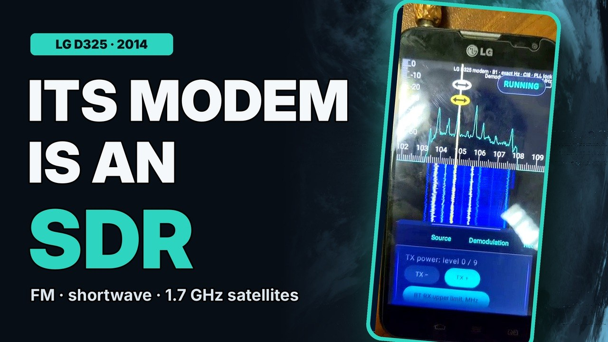

# D325f-SDR


Experimental SDR receiver using the LG D325's built-in cellular modem.
Project and modem integration: **Logan Zarov**.

[Русский](README-RU.md) · [Download 2.0](https://github.com/loganzarov-alt/D325f-SDR/releases/tag/v2.0) ·
[Build](docs/BUILD.md) · [Device setup](docs/DEVICE-SETUP.md) · [Hardware / B8 and B1](docs/HARDWARE.md) ·
[Field notes](docs/FIELD-NOTES.md)

## Features

- LG modem input and IQ file playback.
- Real-time spectrum and waterfall; AM, NFM, WFM, USB, LSB and CW demodulation.
- IQ and demodulated audio recording; the spectrum, waterfall and audio keep
  running while recording.
- Inversion switch for the waterfall and recordings.
- Scheduled recordings that run with the screen off, reception recovery after
  modem failures (zeros fill the gap in the recording), temperature control and
  actions after a recording.
- LNA, DVGA and Bluetooth settings (channel, power level, limit).
- 13 languages.

What is new in 2.0: [release notes](docs/RELEASE-2.0.md). The app has no network
features (server, network client, streaming), and I am not adding them: while
Bluetooth runs as a continuous carrier, Wi-Fi on the LG does not work properly.

7.68 MS/s CI8 IQ (about 5 MHz wide) straight from the modem's baseband, tuned by
a patch to the modem firmware; below 1000 MHz (default) the phone's Bluetooth
transmitter serves as the local oscillator. See [how it works](docs/HOW-IT-WORKS.md) for the
signal path, specifications and limitations.

## Demo

[](https://github.com/loganzarov-alt/D325f-SDR/raw/refs/heads/main/docs/media/d325f-sdr-demo.mp4)

[Video, 1:22](https://github.com/loganzarov-alt/D325f-SDR/raw/refs/heads/main/docs/media/d325f-sdr-demo.mp4): the hardware mod, the modem patch,
FM broadcast and 14.970 MHz shortwave voice with sound, UHF, a 1875 MHz
base-station downlink, my 1.7 GHz antenna and a Meteor-M N2-3 image, all received
by the phone's own modem. IQ recordings from the phone (FM stations with stereo pilot and RDS,
an analog TV carrier at 551.25 MHz, shortwave AM) are analysed in
[how it works](docs/HOW-IT-WORKS.md#recorded-examples).
[Download the three original IQ recordings](https://github.com/loganzarov-alt/D325f-SDR/releases/tag/iq-samples-2026-10-23) (signed CI8, 7.68 MS/s; SHA-256 included).

**Full video on YouTube (2:53):** [youtu.be/WKFZM0AXKjU](https://youtu.be/WKFZM0AXKjU): the hardware mod,
the modem patch, reception through the Bluetooth LO, my 1.7 GHz antenna and Meteor-M N2-3.

## Getting started

Tested setup: an LG D325 (`w5ds`) with LineageOS 14.1, TWRP and root, stock
baseband M8610B-AAAANAZM-1.0.6047, running from a microSD card (its eMMC has failed). Step-by-step guide:
[device setup](docs/DEVICE-SETUP.md).

1. **Hardware**: the B8/B1 bypass wires are brought out to the 3.5 mm jack and an
   antenna is connected through an SMA adapter ([hardware](docs/HARDWARE.md)).
2. **Kernel**: flash kernel build #6 from TWRP (allocates SMEM item 471;
   [source](kernel/README.md)): [boot.img](https://github.com/loganzarov-alt/D325f-SDR/releases/download/kernel-6-source/boot.img)
   for a phone that runs from microSD, or
   [boot-emmc.img](https://github.com/loganzarov-alt/D325f-SDR/releases/download/kernel-6-source/boot-emmc.img)
   for a phone that runs from its eMMC (not tested on a phone yet).
3. **Modem**: with [Modem Patcher 1.1.0](https://github.com/loganzarov-alt/D325f-SDR/releases/tag/modem-patcher-v1.1.0) save a dump,
   copy it to a PC, apply the patch and reboot ([details](modem-patcher/README.md)).
4. **App**: install [D325f SDR 2.0](https://github.com/loganzarov-alt/D325f-SDR/releases/tag/v2.0) (version code 20000, ARMv7,
   Android 7.1+; updates 1.0.0 in place) and grant root.

I confirmed on 24 October 2026 that the app and the modem tools work
on my phone. SDR and live IQ worked on two LG D325f phones: my first prototype, which I later
broke with further hardware modifications, and my current phone.
The software steps are reversible: Boot backup, Restore stock or the saved modem dump.

## Build

Linux x86_64, JDK 17, Python 3 and Android SDK:

```sh
sdkmanager "platforms;android-34" "build-tools;35.0.0" \
  "ndk;27.2.12479018" "cmake;3.22.1"
export ANDROID_HOME=/path/to/android-sdk
./gradlew --no-daemon :app:assembleRelease :app:testReleaseUnitTest
```

Output: `app/build/outputs/apk/release/app-release.apk`.
The app, DSP and custom native helpers build from Java/Kotlin/C/C++/assembly
sources. See [build and signing](docs/BUILD.md) and [verification](validation/README.md).
Proprietary phone firmware and vendor libraries are not included.

## Credits and license

The application includes RF Analyzer code by **Dennis Mantz and contributors**.
AI tools assisted with code development and documentation.

Combined application: **GPL-3.0-or-later**. Original copyright notices and
third-party licenses are retained in [LICENSING.md](LICENSING.md), [LICENSE](LICENSE)
and the app's offline notices. See [code provenance](docs/PROVENANCE.md).
This independent project is not endorsed by LG, Qualcomm or the upstream authors.
