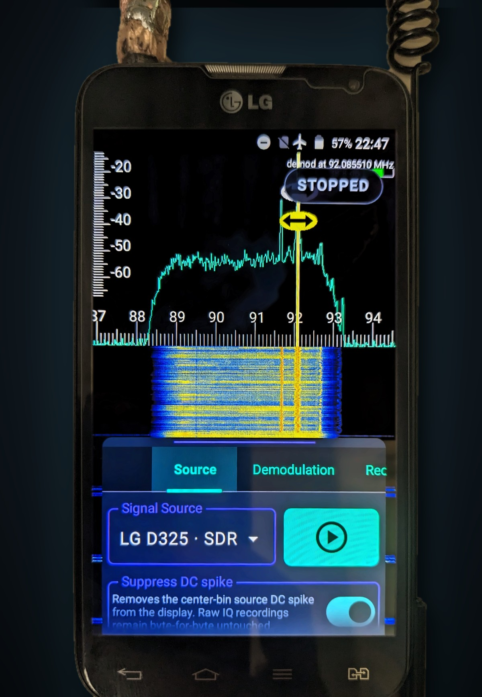
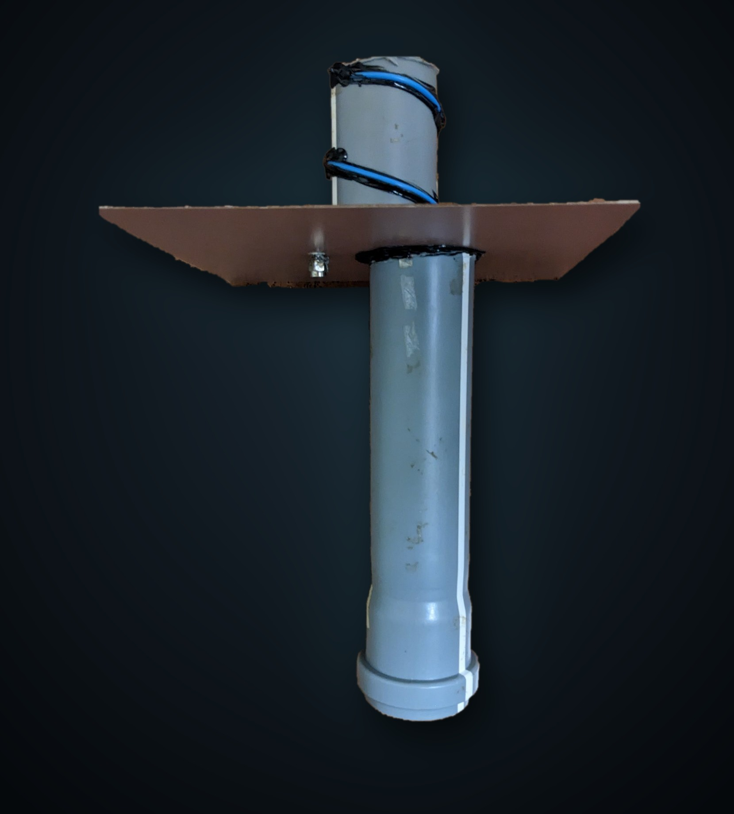
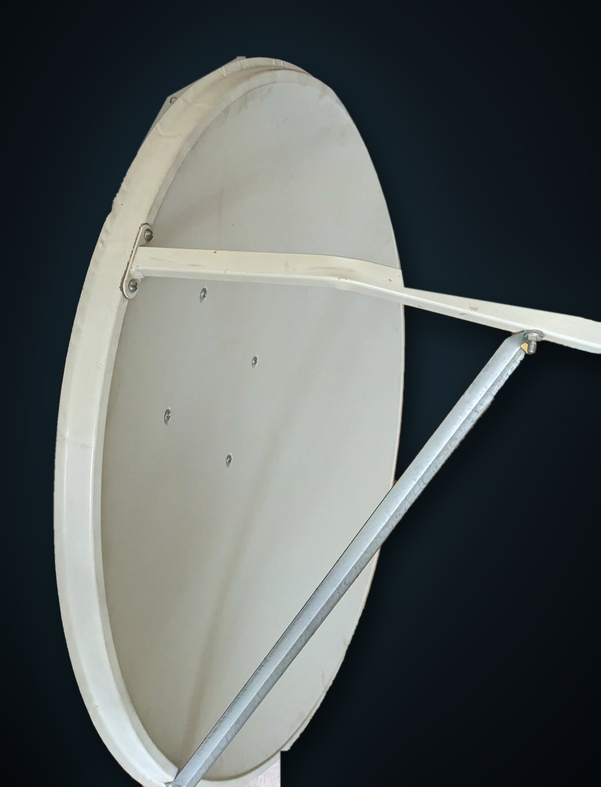
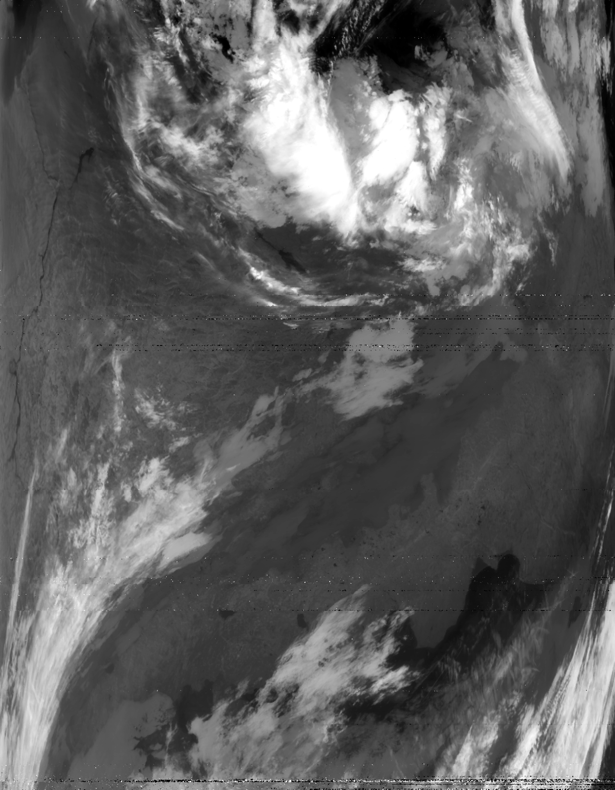
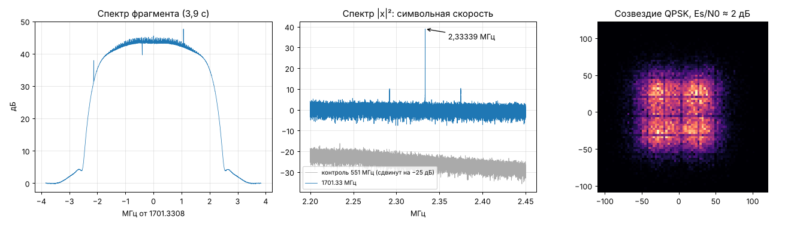

# Field notes / Заметки и измерения

[Русский](#по-русски)

What I learned while using D325f SDR: my phones, calibration, the Bluetooth
local oscillator, measurements, satellites and other phones I tried.

The recordings mentioned below (Meteor frames, a MetOp IQ fragment, the
Bluetooth carrier at every power level) are in the release
[`recordings-2026-11`](https://github.com/loganzarov-alt/D325f-SDR/releases/tag/recordings-2026-11)
with SHA-256 checksums.

## 1. My devices

- I had SDR and live IQ working on two D325f phones. I later broke the first
  prototype with further hardware modifications.
- On my current unit the internal eMMC has failed, and the phone runs entirely
  from a microSD card with the same partition layout (boot, modem and the rest).
  I applied boot.img and the modem patch to the SD partitions. On a phone with a
  working eMMC the procedure is the same in principle: use
  [boot-emmc.img](DEVICE-SETUP.md#2-kernel-bootimg), and the patcher finds the
  modem partition by label and checks the files by SHA-256. I have not tested
  that setup yet — make the Boot backup and the modem dump first.

## 2. Calibration and problem frequencies

- At 1190–1565 MHz and above 2400 MHz the modem PLL does not lock reliably on my
  unit, so reception is intermittent or missing.
- I think the likely cause is RF calibration: the phone runs from microSD with a
  failed eMMC, and its calibration (NV) data, which PLL tuning also depends on,
  may be missing or inaccessible. This is my working hypothesis; I have not
  checked the NV data.
- As far as I remember, my first prototype handled 1190–1565 MHz better.

## 3. Bluetooth local oscillator

- The limit is configurable; in version 2.0 the default is 1000 MHz. In the
  measurements I received 917 MHz through the Bluetooth LO. Up to 1000 MHz this
  mode is stable for me, and I consider it the most promising one.
- **Choosing the channel.** The modem listens on (2402 + channel) − F, so the
  channel decides where the modem itself is tuned. On HF keep the channel number
  at 30 or below (2432 MHz): above that the PLL does not lock. Base-station
  signals, mostly LTE in the 1800 MHz and 2300 MHz bands, degrade reception badly
  if the modem frequency lands inside one of their channels. Pick the channel so
  the modem frequency falls between them; if reception gets worse, move to
  another channel.

  

- **Power level.** The Bluetooth power level has to be chosen individually: the
  optimum depends on the local LTE level and on the signal itself. Level 7
  worked best for me. Levels above 7 are at your own risk. Why: each step above 7
  adds 3–5 dB, level 9 is 8 dB stronger than level 7 (about 6× the power), and
  reception does not improve — at level 9 it is worse than at 7. The extra power
  goes out into the 2.4 GHz band shared with nearby Wi-Fi and Bluetooth and
  brings you closer to the limits set by radio regulations; complying with them
  is your responsibility.

  **The 10 mW limit.** In Russia, general-purpose short-range devices in
  2400–2483.5 MHz are limited to 10 mW EIRP (+10 dBm) (State Radio Frequency
  Commission decision No. 07-20-03-001). The phone's Bluetooth chip, WCN3620,
  outputs typically 13.5 dBm (about 22 mW) at its maximum setting according to
  the manufacturer's specification, which is more than 10 mW. So at the top
  levels the carrier can exceed this limit. Other countries set their own limits.

  **Estimate of absolute power.** I have measured only relative levels. If level 9
  is taken as the WCN3620's typical maximum of 13.5 dBm, level 7 is about
  +5.5 dBm (3.5 mW), level 6 about +1.2 dBm (1.3 mW) and level 5 about −2.4 dBm
  (0.6 mW), plus or minus the antenna gain.

  **Other countries.** In the EU, the UK and other countries that follow
  ERC/REC 70-03, a plain carrier at 2.4 GHz falls under generic short-range
  devices: 10 mW EIRP, as in Russia. The 100 mW limit there is for wideband data
  transmission such as Wi-Fi and Bluetooth, not for an unmodulated carrier. In
  the USA an unmodulated carrier does not qualify for FCC §15.247 (digital
  modulation or frequency hopping, up to 1 W) and falls under §15.249: 50 mV/m at
  3 m, about 0.75 mW EIRP (−1.2 dBm). By the estimate above only levels 0–5 stay
  under it. Power is not the only question: the Bluetooth module is certified for
  normal Bluetooth operation, not for a continuous carrier. Check the rules of
  your own country.

  Carrier power by level (HackRF, same setup for every level, no clipping;
  relative values):

  | Level | Carrier, dBFS | Step, dB | Relative to level 7, dB |
  |---:|---:|---:|---:|
  | 0 | -54.5 | — | -31.1 |
  | 1 | -49.5 | +5.0 | -26.1 |
  | 2 | -44.3 | +5.2 | -20.9 |
  | 3 | -39.0 | +5.3 | -15.6 |
  | 4 | -34.7 | +4.3 | -11.3 |
  | 5 | -31.3 | +3.4 | -7.9 |
  | 6 | -27.7 | +3.6 | -4.3 |
  | 7 | -23.4 | +4.3 | 0 |
  | 8 | -20.0 | +3.4 | +3.4 |
  | 9 | -15.4 | +4.6 | +8.0 |

## 4. 1090 MHz (B8 path)

For 1090 MHz I used PLL profile 2000 ×20 and the B8 input with SAW bypass, with
the antenna on Tip (B8) instead of Ring (B1). I made all other measurements with
the standard adapter (Ring, B1).

## 5. CW measurements

I recorded 23 captures on the LG (CI8, 7.68 MS/s) and 16 on an RTL-SDR V4 (CU8,
2.5 MS/s) of a HackRF CW tone, all inside a shielded enclosure: source and
receiving antenna inside, nothing radiated outside; both series with the same
source and antenna positions. Coupling is over the air inside the box, so the
input level in dBm is unknown: the SNR (in ~1 kHz) compares the receivers under
the same conditions and is not calibrated sensitivity. The figures are
preliminary.

| MHz | LG D325f | RTL-SDR V4 | LG − RTL | Note |
|---:|---:|---:|---:|---|
| 7 | 39.9 | 43.4 | −3.5 | |
| 117 | 45.9 | 47.6 | −1.6 | |
| 217 | 39.3 | 46.7 | −7.3 | |
| 317 | 41.1 | 48.0 | −6.9 | |
| 417 | 49.8 | 46.9 | +2.9 | |
| 433 | 38.0 | 47.8 | −9.8 | LG clipping |
| 517 | 52.0 | 49.3 | +2.7 | |
| 617 | 53.8 | 49.1 | +4.7 | |
| 717 | 52.8 | 47.8 | +5.1 | |
| 817 | 45.2 | 48.7 | −3.5 | |
| 917 | 49.3 | 49.3 | 0.0 | Bluetooth LO |
| 1090 | 51.5 | 44.6 | +7.0 | B8, PLL 2000 ×20 |
| 1190 | 51.0 | 46.3 | +4.7 | unstable PLL lock |
| 1565 | 34.6 | 44.9 | −10.3 | LG clipping; unstable PLL lock |
| 1655 | 46.9 | 46.3 | +0.7 | |
| 1700 | 49.1 | 45.2 | +3.8 | |
| 1800 | 41.2 | — | — | |
| 1900 | 43.5 | — | — | |
| 2000 | 44.9 | — | — | |
| 2100 | 47.5 | — | — | |
| 2200 | 49.9 | — | — | |
| 2300 | 50.9 | — | — | |
| 2400 | 48.6 | — | — | |

SNR in dB in about 1 kHz.

## 6. Satellites

My antenna for 1.7 GHz: a home-made helix feed with a ground plate in front of
a satellite dish.

| Helix feed | Dish |
| --- | --- |
|  |  |

- **Meteor-M No. 2-3 HRPT.** I received the pass on the LG D325 and decoded it
  with SatDump. I lost the original IQ recording; only the frames survived, and
  those are attached. The frames were also checked with a separate decoder:
  2,019 of ~2,050 MSU-MR lines recovered, night pass, image in the IR channels.

  

- **MetOp-B AHRPT, 1701.3 MHz.** I received it with the LG D325 modem, and
  SatDump decodes it down to frame level: the QPSK demodulator holds the signal
  (SNR ≈ 2–5 dB), Viterbi and frame sync lock. Reed-Solomon cannot correct the
  remaining errors, so there is no clean image yet. The signal is at the
  threshold; a clean image needs about 2–3 dB more (LNA at the antenna, filter).
  I attach an IQ fragment and a spectrum analysis.

  

## 6a. Other phones

- **Redmi Note 8T (Snapdragon 665).** Stock FTM, no modem patch: IQ snapshots in
  the stock LTE bands only, with very good sensitivity. It needs my Magisk module
  and a kernel. This is separate work, not part of the LG project.
- **ASUS ZenFone 2 Laser ZE500KL (MSM8916).** The frequency hook works and IQ
  snapshots through FTM are available too, but I could not find the writer — the
  place in the modem firmware from which IQ can be streamed continuously into
  shared memory, as on the LG.
- **Itel Vision 3 (Unisoc SC9863A).** Everything stopped at the modem signature:
  the modem does not accept modified firmware.

## 7. My plan

1. External LNA: I will document power source, gain, filter and ferrites, and
   compare phone power with a separate battery.
2. MetOp: LNA at the antenna, a filter and another pass.
3. Repeat the whole procedure on two more D325 phones and test boot-emmc.img.
4. A microSD boot kit without any LG or Qualcomm firmware, IMEI/NV or personal
   data; Unisoc as a separate research project.

---

## По-русски

Что я узнал, пока пользовался D325f SDR: мои аппараты, калибровка,
Bluetooth-гетеродин, измерения, спутники и другие телефоны.

Записи, о которых идёт речь ниже (кадры Meteor, фрагмент IQ MetOp, несущая
Bluetooth на каждом уровне мощности), — в релизе
[`recordings-2026-11`](https://github.com/loganzarov-alt/D325f-SDR/releases/tag/recordings-2026-11)
с SHA-256.

### 1. Мои аппараты

- SDR и живой поток IQ у меня работали на двух D325f. Первый прототип я потом
  вывел из строя дальнейшими аппаратными доработками.
- На нынешнем аппарате внутренняя eMMC неисправна, и телефон целиком работает с
  microSD с той же разметкой разделов (boot, modem и др.). boot.img и патч модема
  я ставил на разделы SD-карты. На телефоне с исправной eMMC принцип тот же:
  нужен [boot-emmc.img](DEVICE-SETUP.md#2-ядро-bootimg), а патчер находит
  modem-раздел по метке и сверяет файлы по SHA-256. Такую установку я пока не
  проверял — сначала сделайте копию Boot и дамп модема.

### 2. Калибровка и проблемные частоты

- На 1190–1565 МГц и выше 2400 МГц PLL модема у меня захватывается нестабильно,
  приём неустойчив или отсутствует.
- Скорее всего, дело в радиокалибровках: телефон работает с microSD при
  неисправной eMMC, и калибровочные (NV) данные, от которых зависит и настройка
  PLL, могут быть утеряны или недоступны. Это моя рабочая гипотеза, данные NV я
  не проверял.
- На первом прототипе, насколько я помню, диапазон 1190–1565 МГц работал лучше.

### 3. Bluetooth-гетеродин

- Граница настраивается, в версии 2.0 по умолчанию — 1000 МГц. В измерениях
  917 МГц я принял через Bluetooth-гетеродин. Режим до 1000 МГц у меня работает
  стабильно, и я считаю его самым перспективным.
- **Выбор канала.** Модем слушает на (2402 + канал) − F, поэтому канал
  определяет, где настроен сам модем. На КВ ставьте канал не выше 30 (2432 МГц):
  выше PLL не захватывается. Сигналы базовых станций, в основном LTE в
  диапазонах 1800 и 2300 МГц, сильно ухудшают приём, если частота модема
  попадает в полосу такого сигнала. Подбирайте канал так, чтобы частота модема
  оказалась между ними; стало хуже — сдвиньте канал. Пример — фото в
  [английской части](#3-bluetooth-local-oscillator): на 92 МГц частота модема
  попала в канал LTE, и поднялась вся полоса.
- **Уровень мощности.** Уровень мощности Bluetooth подбирается индивидуально:
  оптимум зависит от уровня LTE вокруг и самого сигнала. У меня лучше всего
  работал уровень 7. Уровни выше 7 — на ваш страх и риск. Почему: каждый шаг
  выше 7 добавляет 3–5 дБ, уровень 9 сильнее уровня 7 на 8 дБ (примерно в 6 раз
  по мощности), а приём при этом не улучшается — на уровне 9 он хуже, чем на 7.
  Лишняя мощность уходит в эфир диапазона 2,4 ГГц, где работают Wi-Fi и
  Bluetooth соседей, и приближает вас к пределам, которые устанавливают правила
  использования радиочастот; их соблюдение — ваша ответственность.

  **Ограничение 10 мВт.** В России для устройств малого радиуса действия общего
  назначения в полосе 2400–2483,5 МГц эквивалентная изотропно излучаемая
  мощность (ЭИИМ) — не более 10 мВт (+10 дБм), решение ГКРЧ № 07-20-03-001.
  Bluetooth-чип этого телефона, WCN3620, на максимальной настройке отдаёт
  типично 13,5 дБм (около 22 мВт) по документации производителя, то есть больше
  10 мВт. Поэтому на верхних уровнях несущая может превысить этот предел. В
  других странах действуют свои ограничения.

  **Оценка абсолютной мощности.** Я измерял только относительные уровни. Если
  принять уровень 9 за типичный максимум WCN3620 — 13,5 дБм, то уровень 7 —
  около +5,5 дБм (3,5 мВт), уровень 6 — около +1,2 дБм (1,3 мВт), уровень 5 —
  около −2,4 дБм (0,6 мВт), с поправкой на усиление антенны.

  **Другие страны.** В ЕС, Великобритании и других странах, где действует
  рекомендация ERC/REC 70-03, одиночная несущая на 2,4 ГГц относится к
  устройствам малого радиуса действия общего назначения: 10 мВт ЭИИМ, как в
  России. Предел 100 мВт там — для широкополосной передачи данных (Wi-Fi,
  Bluetooth), а не для немодулированной несущей. В США немодулированная несущая
  не подпадает под FCC §15.247 (цифровая модуляция или скачки частоты, до 1 Вт)
  и относится к §15.249: 50 мВ/м на 3 м, около 0,75 мВт ЭИИМ (−1,2 дБм). По
  оценке выше под этот предел попадают только уровни 0–5. Дело не только в
  мощности: модуль Bluetooth сертифицирован для обычной работы Bluetooth, а не
  для непрерывной несущей. Проверяйте правила своей страны.

  Мощность несущей по уровням (HackRF, одинаковые условия для всех уровней, без
  перегрузки; относительные значения):

  | Уровень | Несущая, dBFS | Шаг, дБ | Относительно уровня 7, дБ |
  |---:|---:|---:|---:|
  | 0 | -54.5 | — | -31.1 |
  | 1 | -49.5 | +5.0 | -26.1 |
  | 2 | -44.3 | +5.2 | -20.9 |
  | 3 | -39.0 | +5.3 | -15.6 |
  | 4 | -34.7 | +4.3 | -11.3 |
  | 5 | -31.3 | +3.4 | -7.9 |
  | 6 | -27.7 | +3.6 | -4.3 |
  | 7 | -23.4 | +4.3 | 0 |
  | 8 | -20.0 | +3.4 | +3.4 |
  | 9 | -15.4 | +4.6 | +8.0 |

### 4. 1090 МГц (тракт B8)

Для 1090 МГц я ставил профиль PLL 2000 ×20 и вход B8 с обходом SAW, а антенну
подключал на Tip (B8) вместо Ring (B1). Остальные измерения я делал со штатным
переходником (Ring, B1).

### 5. Измерения CW

Я записал 23 файла на LG (CI8, 7,68 MS/s) и 16 на RTL-SDR V4 (CU8, 2,5 MS/s),
сигнал CW давал HackRF. Всё снято в экранированном контейнере: источник и
антенна приёмника внутри, наружу сигнал не излучался; обе серии — с одним
источником и одинаковым расположением антенн. Связь через антенны, поэтому
уровень на входе в дБм неизвестен: SNR (в полосе ~1 кГц) сравнивает приёмники в
одинаковых условиях, но это не калиброванная чувствительность. Цифры
предварительные, таблица — в [английской части](#5-cw-measurements).

### 6. Спутники

Моя антенна на 1,7 ГГц — самодельная спираль с рефлектором перед спутниковой
тарелкой (фото в [английской части](#6-satellites)).

- **Meteor-M № 2-3, HRPT.** Я принял пролёт на LG D325 и декодировал в SatDump.
  Исходную IQ-запись я потерял, остались только кадры — их и прикладываю. Кадры
  дополнительно проверены отдельным декодером: восстановлено 2019 из ~2050 строк
  MSU-MR, ночной пролёт, изображение в ИК-каналах.
- **MetOp-B AHRPT, 1701,3 МГц.** Я принял его модемом LG D325, и SatDump
  декодирует его до уровня кадров: демодулятор QPSK держит сигнал (SNR ≈ 2–5 дБ),
  Viterbi и синхронизация кадров захвачены. Reed-Solomon ошибки не исправляет,
  поэтому нормального изображения пока нет. Сигнал у порога, для чистой картинки
  нужен запас 2–3 дБ (LNA у антенны, фильтр). Прикладываю фрагмент IQ и анализ
  спектра.

### 6а. Другие телефоны

- **Redmi Note 8T (Snapdragon 665).** Штатный FTM, без патча модема: снимки IQ
  только в штатных диапазонах LTE, чувствительность очень хорошая. Нужны мой
  модуль Magisk и ядро. Это отдельная работа, в проект LG не входит.
- **ASUS ZenFone 2 Laser ZE500KL (MSM8916).** Частотный хук работает, снимки IQ
  через FTM тоже есть. Но writer — место в прошивке модема, откуда IQ можно
  непрерывно писать в общую память, как на LG, — я найти не смог.
- **Itel Vision 3 (Unisoc SC9863A).** Всё упёрлось в подпись модема: изменённую
  прошивку модем не принимает.

### 7. Мой план

1. Внешний LNA: опишу питание, усиление, фильтр, ферриты; сравню питание от
   телефона и от отдельного аккумулятора.
2. MetOp: LNA у антенны, фильтр и новый пролёт.
3. Повторить всю процедуру ещё на двух D325 и проверить boot-emmc.img.
4. Набор для загрузки с microSD без прошивок LG и Qualcomm, IMEI/NV и личных
   данных; Unisoc — отдельным исследованием.
