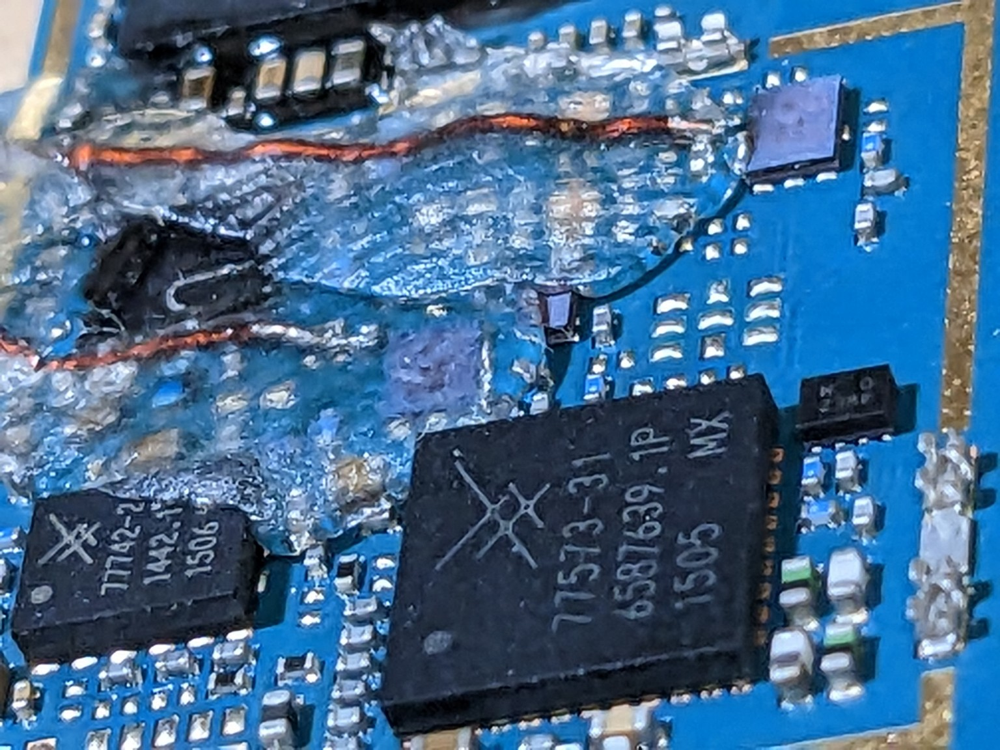
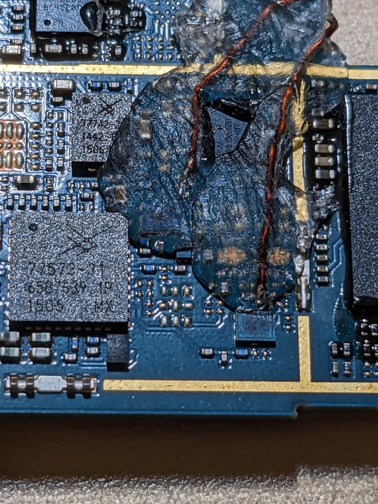
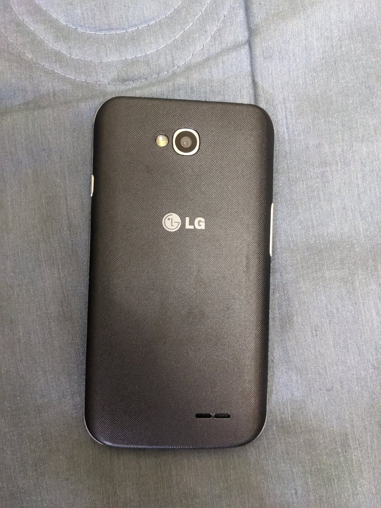
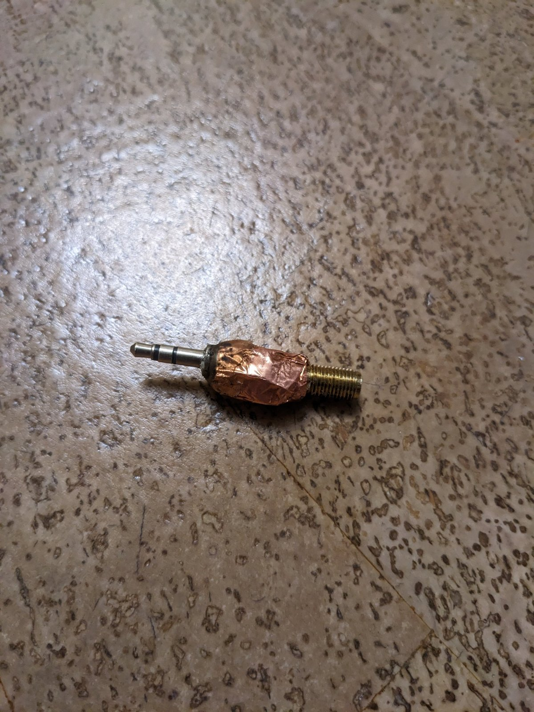
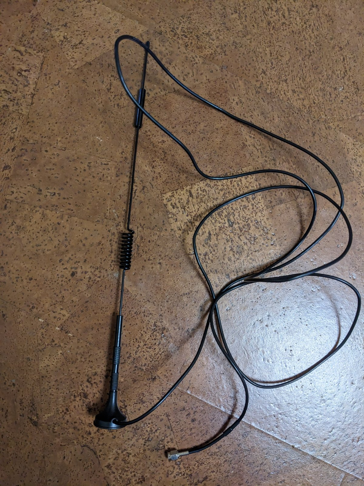

# Hardware modification — B8 / B1

Photographs and band identification supplied by **Logan Zarov** for the modified
LG D325 used with D325f SDR.

## Обозначения / Identification

Ориентир — горизонтальная фотография ниже, в показанном положении платы.
По пояснению автора, **верхняя проволочка, ближе к чипу, — B8; нижняя — B1**.

Use the landscape close-up below in the displayed board orientation.
The author's identification is **B8 for the upper wire, closer to the chip,
and B1 for the lower wire**.

| Диапазон / Band | Проволочка на фото / Wire in the photograph |
| --- | --- |
| **B8** | Верхняя, ближе к чипу / Upper, closer to the chip |
| **B1** | Нижняя / Lower |

## Другой ракурс / Another view

Здесь плата повёрнута: обозначения «верхняя» и «нижняя» относятся к фотографии
выше. / The board is rotated in this view; “upper” and “lower” refer to the
landscape photograph above.

Фотографии показывают существующую доработку. Полная схема и обозначения
контактных площадок пока не опубликованы.

These photographs document the existing modification. A complete circuit diagram
and identified solder pads have not yet been published.

## Test setup / Тестовая установка

In the test setup an external antenna (magnetic-base whip with an SMA plug) is
connected to the phone's 3.5 mm headset jack through a home-made SMA → 3.5 mm
plug adapter shielded with copper foil.

В тестовой установке внешняя антенна (штырь на магнитном основании, разъём SMA)
подключается к гнезду наушников 3,5 мм через самодельный переходник
SMA → 3,5 мм, экранированный медной фольгой.

| LG D325 | SMA → 3.5 mm adapter | Antenna |
| --- | --- | --- |
|  |  |  |

[Device setup / Подготовка телефона](DEVICE-SETUP.md) · [README](../README.md)
