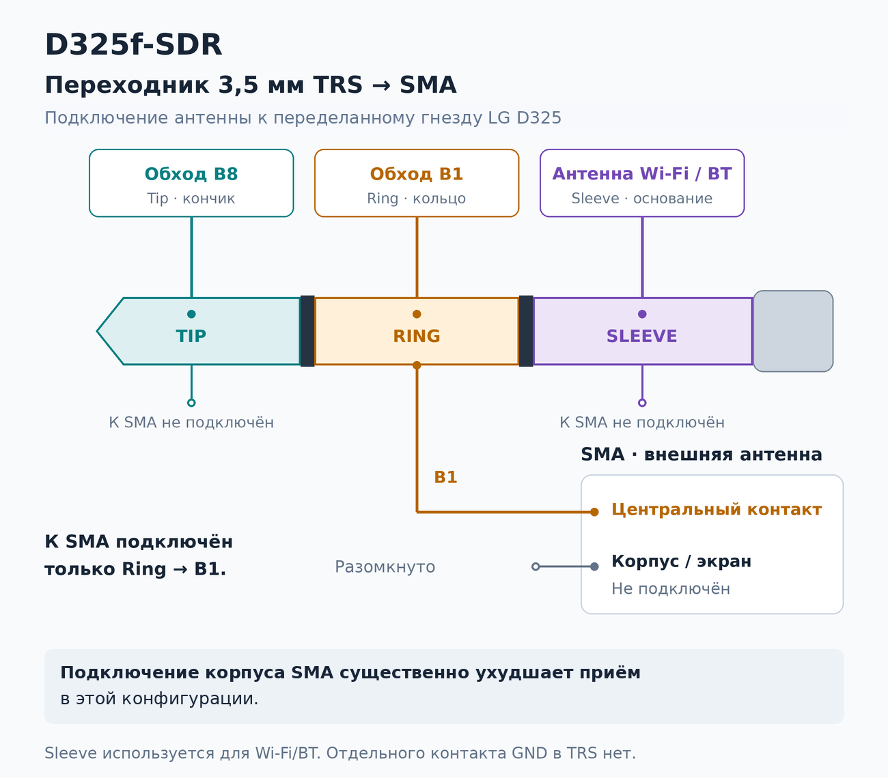

# Hardware modification — B8 / B1

Modified LG D325 used with D325f SDR. Photographs: **Logan Zarov**.

## Обозначения / Identification

Ориентир — горизонтальная фотография ниже, в показанном положении платы.
**Верхняя проволочка, ближе к чипу, — B8; нижняя — B1**.

Use the landscape close-up below in the displayed board orientation.
**B8 is the upper wire, closer to the chip; B1 is the lower wire**.

| Диапазон / Band | Проволочка на фото / Wire in the photograph |
| --- | --- |
| **B8** | Верхняя, ближе к чипу / Upper, closer to the chip |
| **B1** | Нижняя / Lower |

## Другой ракурс / Another view

Здесь плата повёрнута: обозначения «верхняя» и «нижняя» относятся к фотографии
выше. / The board is rotated in this view; “upper” and “lower” refer to the
landscape photograph above.

Фотографии показывают существующую доработку. Полная схема и обозначения
контактных площадок пока не опубликованы.

These photographs document the existing modification. A complete circuit diagram
and identified solder pads have not yet been published.

## Test setup / Тестовая установка

In the test setup an external antenna (magnetic-base whip with an SMA plug) is
connected to the phone's 3.5 mm headset jack through a home-made SMA → 3.5 mm
plug adapter wrapped in copper foil.

В тестовой установке внешняя антенна (штырь на магнитном основании, разъём SMA)
подключается к гнезду наушников 3,5 мм через самодельный переходник
SMA → 3,5 мм, обёрнутый медной фольгой.

| LG D325 | SMA → 3.5 mm adapter | Antenna |
| --- | --- | --- |
|  |  |  |

## TRS pinout and adapter / Распиновка TRS и переходника

The phone's 3.5 mm jack has been repurposed. The three TRS contacts connect as follows:

Гнездо 3,5 мм переделано. Подключение трёх контактов TRS:

| Contact / Контакт | Connection inside the phone / Подключение в телефоне | Connection in this adapter / Подключение в переходнике |
| --- | --- | --- |
| Tip — кончик | B8 bypass / Обход B8 | Not connected to SMA / К SMA не подключён |
| Ring — кольцо | B1 bypass / Обход B1 | SMA centre contact / Центральный контакт SMA |
| Sleeve — основание | Wi-Fi/BT antenna / Антенна Wi-Fi/BT | Not connected to SMA / К SMA не подключён |

**Only the SMA centre contact is connected, to Ring (B1).** The SMA body/shield
is left unconnected: connecting it substantially worsens reception in this setup.
Sleeve carries the Wi-Fi/BT antenna connection; it is not a separate ground contact.

**Центральный контакт SMA подключён только к Ring (B1).** Корпус/экран SMA
оставлен неподключённым: его подключение существенно ухудшает приём в этой
конфигурации. Sleeve связан с антенной Wi-Fi/BT; отдельного контакта земли здесь нет.

This describes the wiring of the demonstrated setup. The physical coupling path
from the Bluetooth local oscillator into the receiver has not yet been characterised;
the pinout alone does not establish that mechanism. See the
[Bluetooth mode description](HOW-IT-WORKS.md#bluetooth-local-oscillator-below-800-mhz).

Здесь показана разводка демонстрируемой установки. Физический путь связи
Bluetooth-гетеродина с приёмником ещё не определён измерениями; сама распиновка
не устанавливает механизм этой связи.

[Device setup / Подготовка телефона](DEVICE-SETUP.md) · [README](../README.md)
