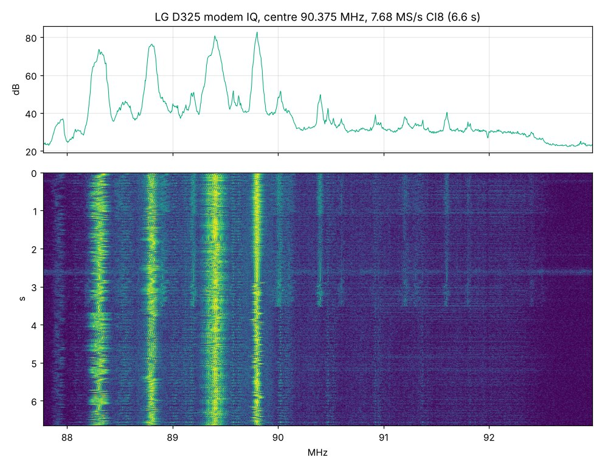
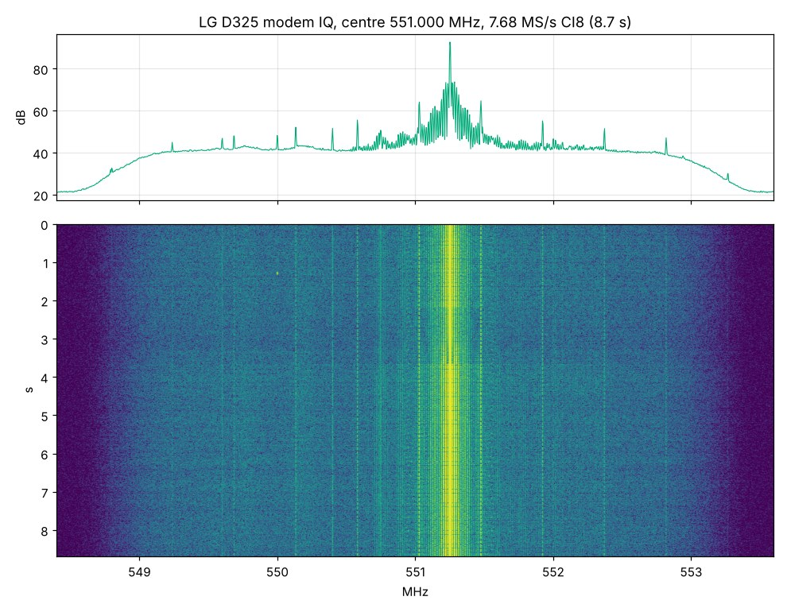
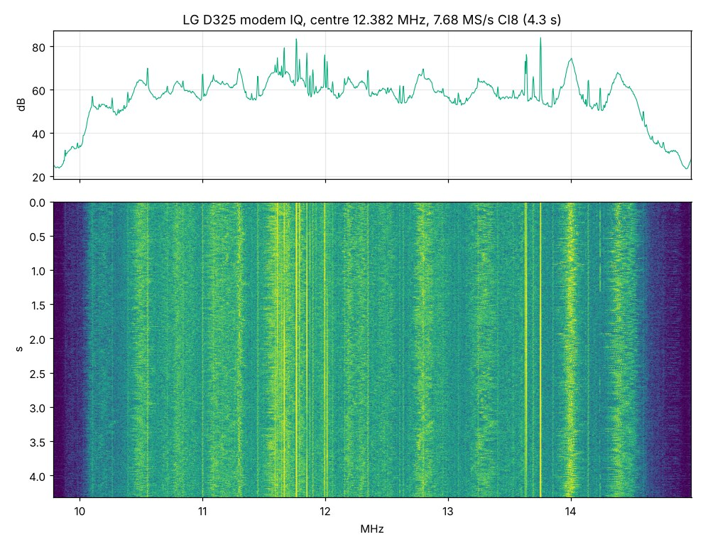

# How it works / Как это работает

[Русский](#по-русски)

The LG D325 has a Qualcomm MSM8610 modem (Hexagon DSP, baseband
M8610B-AAAANAZM-1.0.6047) with a WTR-family RF transceiver. Normally its
digital baseband samples never leave the modem. D325f SDR makes the modem
publish them to Android and turns the phone into a receiver.

```
antenna path (B1 / B8, see HARDWARE.md)
   │
WTR transceiver ── PLL set to any frequency by the D3FQ hook
   │
Hexagon modem firmware (patched, factory test mode)
   │  IRQ hook copies every hardware IQ block
   ▼
SMEM item 471 ring, 126,976 bytes  ◄── reserved by the kernel patch
   │
lg_stream (native helper, root) reads the ring from user space
   │
D325f SDR app (RF Analyzer DSP): FFT, waterfall, demodulation, recording
```

## Pieces

| Piece | What it does | Where |
| --- | --- | --- |
| Modem patch | Adds an FTM902 command handler and an IRQ-driven producer that fills a CI8 ring in shared memory; hooks the stock RX/TX PLL calculation so any 64-bit frequency in Hz can be requested (D3FQ). 6 files, 2,672 bytes. | [`modem-patcher/`](../modem-patcher/README.md) |
| Kernel | Allocates SMEM item 471 (128 KiB) for the ring. Patch against LineageOS `android_kernel_lge_msm8226` (cm-14.1). | [`kernel/`](../kernel/README.md) |
| Native helper | Puts the modem into factory test mode over DIAG, tunes it, starts the ring and streams blocks to the app; restores normal mode on exit. | [`native/from-source/`](../native/from-source/) |
| App | RF Analyzer–based UI and DSP with an LG modem source. | [`app/`](../app/), [`nativedsp/`](../nativedsp/) |
| Hardware | Two wires on the RF board for the B8 and B1 paths. | [HARDWARE.md](HARDWARE.md) |

## Specifications

| | |
| --- | --- |
| Sample format | interleaved signed 8-bit I/Q (CI8) |
| Sample rate | 7.68 MS/s native (about 5 MHz usable); 2.56 and 1.28 MS/s modes in the app |
| Tuning | arbitrary frequency in Hz; streaming starts only after the modem reports PLL lock |
| PLL lock confirmed | 1700, 2120, 2140, 2160 and 2170.123456 MHz (B1 path); 5000 MHz did not lock and is refused |
| Below 800 MHz | Bluetooth local oscillator, see below; FM broadcast at 93.5 MHz received |
| Gain | fixed: LNA range 0 (maximum), DVGA offset 0 |
| Ring buffer | 126,976 bytes, about 8.3 ms at 7.68 MS/s |
| Longest documented run | 158 s, 1,186,008 blocks, no dropped blocks |

### Bluetooth local oscillator (below 800 MHz)

Below a configurable limit (default 800 MHz) the app keys a continuous
**transmit** carrier from the phone's Bluetooth chip (WCN36x0) on
2402 + channel MHz (channel 0–78, power level 0–9) and tunes the modem to
(2402 + channel) − F, where F is the wanted frequency. Above the limit the modem
receives directly. This mode transmits in the 2.4 GHz ISM band while it is
active.

## Recorded examples

IQ files recorded on the phone with the app (7.68 MS/s CI8) and analysed on a
PC. All three are below 800 MHz, so they were received through the Bluetooth
local oscillator. In all three the I/Q levels are balanced and uncorrelated,
nothing is clipped and the streams have no dropouts.

**FM broadcast, centre 90.375 MHz, 6.6 s.** Six stations in the window
(about 88.3, 88.8, 89.2, 89.4, 89.8 and 90.0 MHz). After FM demodulation every
one shows the 19 kHz stereo pilot 19–50 dB above its neighbourhood; 89.4 MHz
also carries the 57 kHz RDS subcarrier.



**Analog TV, centre 551 MHz, 8.7 s.** Vision carrier at 551.252 MHz
(channel 31, nominal 551.25 MHz). The carrier's envelope is modulated at the
15,625 Hz line rate and its harmonics, 49–52 dB above the background, and the
spectral lines around it are spaced 15.6 kHz.



**Shortwave, centre 12.382 MHz, 4.3 s.** AM broadcast stations in the 25 m and
22 m bands. The carriers at 11.765 and 13.751 MHz are amplitude-modulated with
audio (envelope power 17–27 dB higher in the speech band than outside it);
the 11.765 MHz carrier is within 0.1 kHz of its nominal frequency.



## Limitations

- Tested on one modified LG D325. A full procedure from a stock phone has not
  been repeated on a second device.
- Sensitivity and absolute frequency accuracy have not been measured with a
  signal generator. PLL lock confirms the synthesizer, not the RF front end.
- Reception stops when the CPU is overloaded or the phone overheats; the ring
  covers only about 8 ms.
- Retuning during long runs is not fully validated.

---

## По-русски

В LG D325 стоит модем Qualcomm MSM8610 (Hexagon, baseband
M8610B-AAAANAZM-1.0.6047) с трансивером семейства WTR. Обычно его цифровые IQ
не выходят за пределы модема. D325f SDR заставляет модем отдавать их в Android.

- **Патч модема** добавляет обработчик FTM902 и producer по прерыванию, который
  кладёт каждый аппаратный блок IQ в кольцо CI8 в SMEM, и хук перед штатным
  расчётом PLL, позволяющий задать любую частоту в Гц (D3FQ).
- **Ядро** выделяет SMEM 471 (128 КиБ) под кольцо ([`kernel/`](../kernel/README.md#по-русски)).
- **Нативный помощник** переводит модем в FTM через DIAG, настраивает частоту,
  запускает кольцо и передаёт блоки приложению.
- **Приложение** на основе RF Analyzer: спектр, водопад, демодуляция, запись.
- **Доработка платы**: две проволоки для трактов B8 и B1.

Формат CI8, 7,68 MS/s (около 5 МГц полезной полосы), режимы 2,56 и 1,28 MS/s.
Захват PLL подтверждён на 1700 и 2120–2170 МГц; 5000 МГц не захватывается и
отклоняется. Ниже 800 МГц (настраивается) используется Bluetooth-гетеродин:
приложение включает непрерывную **передачу** несущей Bluetooth на
2402 + канал МГц, а модем настраивается на (2402 + канал) − F. Так принято
FM-вещание на 93,5 МГц. Усиление фиксировано (LNA 0, DVGA 0). Кольцо —
около 8,3 мс; самый длинный задокументированный приём — 158 с без потерь.

Примеры записей с телефона (графики выше): FM-диапазон около 90,4 МГц — шесть
станций, у всех стереопилот 19 кГц, у 89,4 МГц RDS; аналоговое ТВ на 551,25 МГц —
строчная частота 15 625 Гц в огибающей; КВ около 12,4 МГц — AM-вещание со звуком
на 11,765 и 13,751 МГц. Все три приняты через Bluetooth-гетеродин.

Ограничения: проверено на одном аппарате; чувствительность и точность частоты
генератором не измерялись; при перегрузке процессора или перегреве приём
останавливается.
